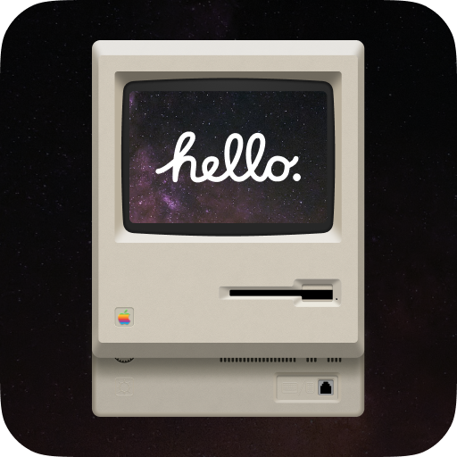

# MacOS Molten Patcher



A Kitten Space Agency mod that lets the Windows version of the game run on macOS in a [Sikarugir Wine wrapper](https://github.com/Sikarugir-App/Sikarugir), by patching the wrapper and the game files.

**Tested with `KSA 2026.10.13.5602` on engine `WS12WineSikarugir11.0_1`.**

## How it works

Before the game starts, a StarMap hook applies each file in the mod's `patches/` folder, in name
order. It only runs inside a Sikarugir wrapper; elsewhere it does nothing.

Each patch is a plain text file: a title, an explanation of why it exists and when it can be
removed, a `---` line, then the change itself. There are two kinds:

- `.patch`: a diff of one text file, as `git diff` prints it. Lines are matched by their text,
  not by line numbers, so a patch survives small changes to the file around it.
- `.replace`: a whole file, for binaries. It names the target and lists the shell commands that
  build the new file (`build.sh` runs them); the built file ships in `files/`.

The target is a path inside the game folder, or inside the wrapper's `Contents` folder when it
starts with `wrapper:`. Patches cannot reach anywhere else.


## Install

Requires [StarMap](https://github.com/StarMapLoader/StarMap). Recommended wrapper engine: `WS12WineSikarugir11.0_1`.

**[Install via Borea](https://ksamodding.github.io/Borea/mod/MacOSMoltenPatcher/)**

-- or --

1. Download `MacOSMoltenPatcher.zip` from the [latest release](https://github.com/renancamm/ksa-macos-molten-patcher/releases/latest), or build it (see [Build](#build)).
2. Extract the `MacOSMoltenPatcher` folder into KSA's mods folder
   (`Documents/My Games/Kitten Space Agency/mods/`).
3. Start the game through StarMap.

## Build

Needs macOS with Xcode, Python 3.11 and the .NET 10 SDK. From the repo folder:

```sh
./build.sh
dotnet build -c Release -o out/MacOSMoltenPatcher
```

## Uninstall

The patches change files in your wrapper and game folder. **Removing the mod does not undo them.**
The mod keeps each original file next to it as `<file>.orig`.

To undo the changes:

1. In the mod folder, open `uninstall.toml` and set `revert_changes = true`.
2. Start the game through StarMap once. The mod restores the original files. The game may not
   start on this launch.
3. Remove the mod.

## Licenses

Mod code: MIT. Bundled third-party files come with their licenses in the `licenses/` folder.
